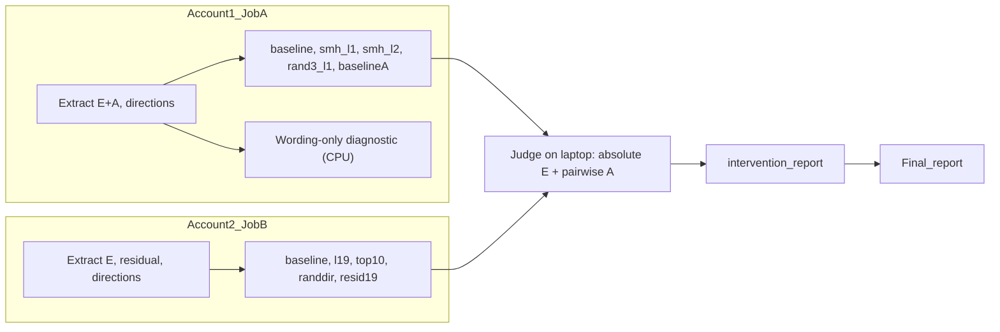

# AttentionSeekers: End-Submission Plan (Team Overview)

**Situation:** the deadline is tomorrow night. The mid-sub already presented the Workstream 3 results (see `MIDSUB_RESULTS.md` and `Workstream_3/docs/ws3_summary.md`), so the final report needs **new results** plus a clean write-up.

**Strategy:**
- Run one causal experiment, removing the user-style direction (H5), for Extraversion only.
- Add three cheap validity checks that the mid-sub review flagged.
- Spend everything else on the report.

**Compute:** two Ada accounts, each with 2-4 RTX 2080 Ti cards (11 GB), each job capped at 6 hours. We submit **two self-contained overnight jobs**, one per account. Each should take **about 1-2.5 hours on 2 GPUs**.

---

## Where we stand (shown at mid-sub)

- Our extraction matches the reference implementation. Assigned E/A localization puts the SMHs (layer 19, heads 2/4/27) in the top 3 of layer 19.
- User style reaches the same heads, but not in the same direction as the system prompt.
- Qwen mirrors **Extraversion** (+13 points) but shows no visible Agreeableness mirroring, because A sits at a ceiling of ~91.
- In the factorial regression, user style explains 0.6% of SMH variance; the system prompt explains 69%.
- Zeroing the SMHs does **not** reduce E mirroring.

**Open mid-sub issues and their status:**
- **The repo rejected low-pole user variants.** Fixed; all 120 E and 120 A variants validate.
- **The random control triples included head 2.** Fixed; random triples now exclude 2, 4 and 27.
- **The wording-only control was missing.** Now runs in Job A.
- **Agreeableness was uninterpretable.** Now handled by pairwise judging.
- **The human 10% audit.** Still to do by hand (no GPU; ~1 hour, `Data_Creation/data/qc/manual_check.csv`).

## What we cut

These go in Limitations and Future Work:

- Llama replication
- The other three Big Five traits
- Multi-turn drift (conclusions stay scoped to **single-turn**)
- The adoption-vs-perception analysis (H4)
- Re-running SMH zero-ablation (already null at mid-sub)
- SMH dose-response at lambda 4

---

## Design decisions (after review)

- **Greedy decoding for every arm.** Generation is deterministic, so an arm differs from its job's baseline only because of the hook, not because of sampling noise. That allows 1 sample per prompt instead of 2.
  - Caveat: mid-sub mirroring used temperature 1.0, so the greedy baseline M is a new number. **Judge the baselines first** in the morning.
- **lambda = 1 is the removal test** (`z <- z - u u^T (z - mu0)` removes the user component). lambda = 2 *reflects* the component, which pushes toward the opposite style. It is reported only as **steering**.
- **Directions are cross-fit in 4 folds by scenario.** Each held-out scenario is generated with a direction fit on the other 15. The top-10 heads are also picked per fold.
- **Persona preservation uses the factorial 2x2 (system E+/- x user E+/-, paraphrase 0 only)**, not a neutral user. Paraphrase 0 is the sociability facet, which is the facet that mirrored strongly at mid-sub. The report must say the conflict results are for that facet only. This yields three numbers per arm:
  - the assigned-persona effect (RQ3: is the persona kept?)
  - the user effect under a persona (B4: does an assigned persona resist the user?)
  - the conflict gap
- **Precision:** fp16, sharded across 2 GPUs. Fallback: `qwen_ada_fp32.json` on 4 GPUs (bf16 is not native on Turing cards).
- **Positive control:** removing the user direction from the **residual stream** at layer 19 (the decoder-layer output). If that fails too, direction removal at this layer does not work at all. If it works while the SMH arm does not, the direction is used, just not via the SMHs.

## Generations

| Set | Per arm | What |
| --- | --- | --- |
| Mirroring | 120 | E user variants (20 scenarios x 2 poles x 3 paraphrases), neutral system |
| Factorial 2x2 | 80 | E system +/- x E user +/-, paraphrase 0 |
| A baseline (Job A only) | 120 | A user variants, no hook, for pairwise judging |

## The two jobs (arms in priority order)

**Job A (account 1): SMHs, plus the validity checks**
- Extraction covers the E and A system twins too (660 rows), which enables the wording-only diagnostic.
- CPU, in the background: fp16 localization of assigned E, assigned A and user E, plus the **wording-only (same-pole) diagnostic with SMH ranks**.
- Arms:
  1. `baseline`
  2. `smh_l1`: the H5 removal test
  3. `smh_l2`: steering
  4. `rand3_l1`: random triple, no SMH
  5. `baselineA`: A variants, for pairwise judging
- Total: 4 x 200 + 120 = **920 generations**.

**Job B (account 2): beyond the SMHs**
- Extraction covers E variants and neutral rows (340 rows), plus the residual readout at layer 19.
- Arms:
  1. `baseline`
  2. `l19_l1`: all 28 heads of layer 19
  3. `top10_l1`: top-10 user-style heads network-wide
  4. `randdir19_l1`: random direction in layer 19
  5. `resid19_l1`: residual-stream positive control
  6. `l19_l2`: steering
- Total: 6 x 200 = **1,200 generations**.

**How to read the results:**
- **`smh_l1` reduces mirroring:** the SMH direction carries the user's style (the projection version of the mid-sub null).
- **Only `l19_l1`, `top10_l1` or `resid19_l1` reduce it (and beat `randdir19_l1`):** mirroring runs through the direction, but not via the SMHs.
- **Nothing does, including the residual arm:** single-turn mirroring is not removable along one direction at layer 19.
- **Steering arms (lambda 2):** these show whether the direction can push style at all.

### GPU time per job (2 GPUs, one worker)

| Step | Estimate |
| --- | --- |
| Copy weights to scratch + model loads | 10-15 min |
| Extraction (340-660 rows) + residual (B) + directions | 10-15 min |
| Generation, at ~2.5 s each (worst case 5 s) | A: 920 → ~40 min (77 min); B: 1,200 → ~50 min (100 min) |
| **Total** | **~1-2.5 h**; with 4 GPUs (two workers) it is shorter |

Submit with `--time=06:00:00`. Generation resumes from `gen.jsonl`, so if a job dies, just resubmit it.

---

## Code (done; tests pass on CPU)

| File | What |
| --- | --- |
| `Workstream_2/configs/qwen_ada.json`, `qwen_ada_fp32.json` | fp16 on 2 GPUs; fp32 fallback on 4 |
| `attentionseekers/extract.py` | `device: "auto"` shards the model with `max_memory` |
| `ws3/generate.py` | `projection_hook`; greedy decoding when temperature is 0; reuses a loaded model |
| `ws3/residual.py` | Residual readout at a decoder layer, plus `layer_output_hook` |
| `ws3/directions.py` | Cross-fit directions: smh, l19, rand3 (no SMH), top10, randdir19, resid19 |
| `ws3/project.py` | Arms x folds, job presets A/B, worker split, resumable |
| `ws3/diagnostic.py` | The same-pole null now saves SMH ranks |
| `ws3/pairwise.py` | Pairwise high-vs-low judge, both orders (for A, and optionally E) |
| `ws3/intervention_report.py` | Mirroring reduction and factorial contrasts vs. the same-job baseline; figure |
| `ws3/ada_smoke.py`, `scripts/ada_smoke.sh` | Checks greedy repeatability, lambda=0 identity (head and residual hooks), finite activations, s/gen |
| `scripts/ada_env.sh`, `ada_setup.sh`, `ada_job.sh` | Environment, one-time setup, overnight job |

## Runbook

1. **Each account, once.** Copy the repo, then run `bash Workstream_3/scripts/ada_setup.sh` on a node with internet. It runs uv sync, downloads the weights, and runs the tests.
2. **Smoke test (one account).** `sbatch Workstream_3/scripts/ada_smoke.sh`. It must say `"verdict": "OK"`. Check the `seconds_per_generation` value. If anything is NaN, set `CONFIG=Workstream_2/configs/qwen_ada_fp32.json` and use 4 GPUs.
3. **Submit:**
   - `sbatch --export=ALL,JOB=A Workstream_3/scripts/ada_job.sh` (account 1)
   - `sbatch --export=ALL,JOB=B Workstream_3/scripts/ada_job.sh` (account 2)
   - Add `--gres=gpu:4` if available. Add `-A`/`-p` as the account requires.
4. **Morning:**
   - Copy back `$ADA_STORE/results/job{A,B}/export_job*.tar.gz`.
   - Judge the baselines first, then every E arm: `python -m ws3.judge --generations arms/<arm>/gen.jsonl --out judged/<arm> --cache cache`.
   - Run `python -m ws3.pairwise --generations jobA/arms/baselineA/gen.jsonl --trait A --out pairwise/A --cache cache`, and the same with `--trait E` on `jobA/arms/baseline` as a sanity check.
   - Run `python -m ws3.intervention_report --job A=judged/jobA --job B=judged/jobB --out report`.

## Report

- Start from the mid-sub write-up (`MIDSUB_RESULTS.md`) and the WS3 summary.
- **Method:** add greedy decoding, cross-fitting, lambda = 1 removal vs. lambda = 2 steering, factorial preservation, and the residual control.
- **Results:**
  - the projection table and figure
  - the wording-only diagnostic (does the SMH headline survive?)
  - pairwise agreeableness
  - the human-audit numbers
- **Limitations:**
  - single-turn only
  - one model
  - E/A only
  - the intervention runs used fp16 on 2080 Ti cards with greedy decoding, while mid-sub used bf16 on a 3090 at temperature 1. Arms are compared only within their own job.
- **Citations:** Lu et al. (title and authors), Izawa as ICML 2026 (arXiv 2603.13249), the Subramani misattribution, the Beckmann and Butlin sentence, and the BibTeX author fields.

## Who does what

| Person | Tonight | Tomorrow |
| --- | --- | --- |
| 1 | Ada setup + smoke test on account 1, submit Job A | Fix or resubmit; figures |
| 2 | Ada setup on account 2, submit Job B | Judging, pairwise, `intervention_report` |
| 3 | Report: Intro, Related Work, citations; the human 10% audit | Discussion, Limitations |
| 4 | Report: Method and the existing Results | New Results sections, proofread, submit |

## Checklist

- [x] Code: multi-GPU loading, hooks, directions, arms, residual, pairwise, report, Ada scripts
- [ ] `ada_setup.sh` on both accounts
- [ ] Smoke test verdict OK, s/gen recorded
- [ ] Job A and Job B submitted
- [ ] Baselines judged first (greedy M is large enough to work with)
- [ ] All arms judged; pairwise A done; `intervention_report` figure done
- [ ] Human 10% audit
- [ ] Report written and submitted
